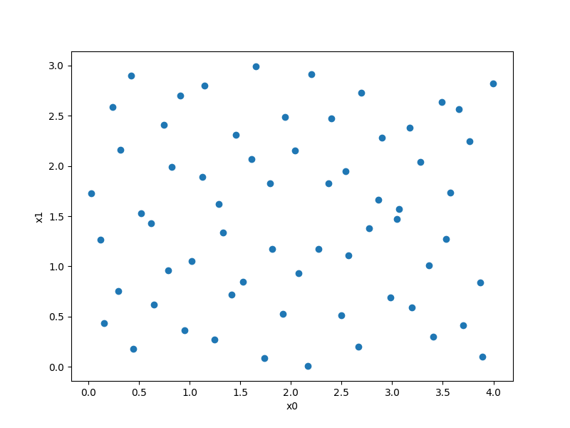
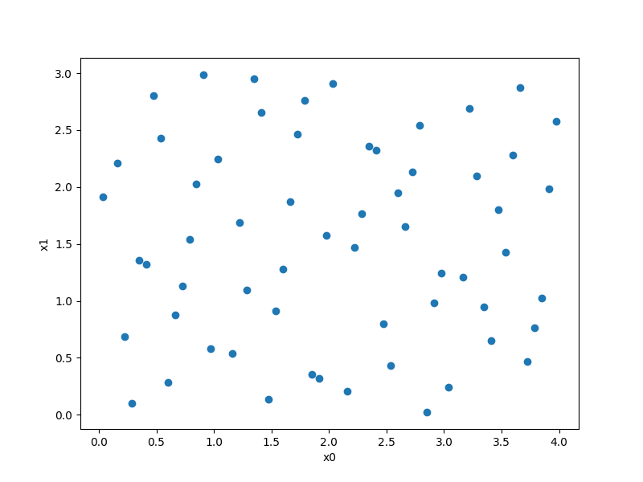

Quasi-Monte Carlo sampling (Sobol & Halton)
===========================================

SMT exposes wrapped SciPy Quasi-Monte Carlo (QMC) low-discrepancy sequence
generators [1]_ (`Sobol` and `Halton`) through the standard `SamplingMethod`
interface (`ScaledSamplingMethod`), automatically mapping samples from the unit
hypercube :math:`[0, 1]^{nx}` to user-specified `xlimits`.

.. [1] Owen, A. B. (1995). "Randomly permuted (t, m, s)-nets and (t, s)-sequences." Monte Carlo and Quasi-Monte Carlo Methods in Scientific Computing, pp. 299-317.

Sobol sampling
--------------

Usage
^^^^^

.. code-block:: python

  import matplotlib.pyplot as plt
  import numpy as np
  
  from smt.sampling_methods import Sobol
  
  xlimits = np.array([[0.0, 4.0], [0.0, 3.0]])
  sampling = Sobol(xlimits=xlimits, seed=42)
  
  num = 64
  x = sampling(num)
  
  print(x.shape)
  
  plt.plot(x[:, 0], x[:, 1], "o")
  plt.xlabel("x0")
  plt.ylabel("x1")
  plt.show()
  
::

  (64, 2)
  

Options
^^^^^^^

.. list-table:: List of options
  :header-rows: 1
  :widths: 15, 10, 20, 20, 30
  :stub-columns: 0

  *  -  Option
     -  Default
     -  Acceptable values
     -  Acceptable types
     -  Description
  *  -  xlimits
     -  None
     -  None
     -  ['ndarray']
     -  The interval of the domain in each dimension with shape nx x 2 (required)
  *  -  scramble
     -  True
     -  None
     -  ['bool']
     -  Whether to apply scrambling to the QMC sequence
  *  -  seed
     -  None
     -  None
     -  ['NoneType', 'Integral', 'Generator']
     -  Numpy Generator or integer seed controlling sequence scrambling

Halton sampling
---------------

Usage
^^^^^

.. code-block:: python

  import matplotlib.pyplot as plt
  import numpy as np
  
  from smt.sampling_methods import Halton
  
  xlimits = np.array([[0.0, 4.0], [0.0, 3.0]])
  sampling = Halton(xlimits=xlimits, seed=42)
  
  num = 60
  x = sampling(num)
  
  print(x.shape)
  
  plt.plot(x[:, 0], x[:, 1], "o")
  plt.xlabel("x0")
  plt.ylabel("x1")
  plt.show()
  
::

  (60, 2)
  

Options
^^^^^^^

.. list-table:: List of options
  :header-rows: 1
  :widths: 15, 10, 20, 20, 30
  :stub-columns: 0

  *  -  Option
     -  Default
     -  Acceptable values
     -  Acceptable types
     -  Description
  *  -  xlimits
     -  None
     -  None
     -  ['ndarray']
     -  The interval of the domain in each dimension with shape nx x 2 (required)
  *  -  scramble
     -  True
     -  None
     -  ['bool']
     -  Whether to apply scrambling to the QMC sequence
  *  -  seed
     -  None
     -  None
     -  ['NoneType', 'Integral', 'Generator']
     -  Numpy Generator or integer seed controlling sequence scrambling
