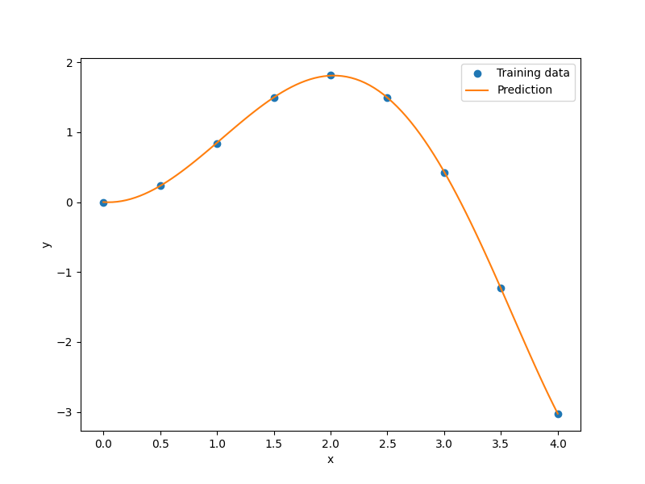
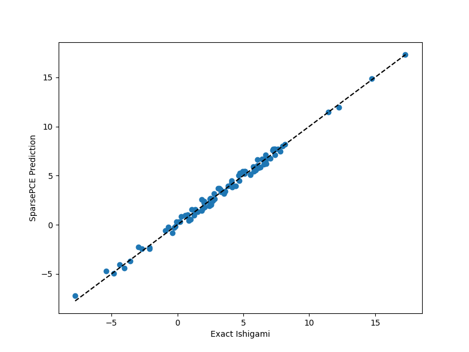

Polynomial Chaos Expansion (PCE & SparsePCE)
============================================

Polynomial Chaos Expansion (PCE) [1]_ represents a square-integrable model response
:math:`Y = \mathcal{M}(\mathbf{X})` with independent continuous input random variables
:math:`\mathbf{X} = (X_1, \dots, X_{nx})` as a convergent expansion on multivariate
orthonormal polynomials:

.. math ::
  \mathcal{M}(\mathbf{x}) \approx \sum_{\boldsymbol{\alpha} \in \mathcal{A}} c_{\boldsymbol{\alpha}} \Psi_{\boldsymbol{\alpha}}(\mathbf{z}(\mathbf{x})),
  \qquad \Psi_{\boldsymbol{\alpha}}(\mathbf{z}) = \prod_{j=1}^{nx} \psi_{\alpha_j}^{(j)}(z_j),

where :math:`\{\psi_k^{(j)}\}_{k \ge 0}` satisfies the Favard symmetric three-term recurrence
orthonormal with respect to marginal :math:`j` (:math:`\mathbb{E}[\Psi_{\boldsymbol{\alpha}}\Psi_{\boldsymbol{\beta}}] = \delta_{\boldsymbol{\alpha}\boldsymbol{\beta}}`).

Key Capabilities
----------------

- **Orthonormal polynomial bases**: Wiener-Askey families (Legendre for Uniform,
  probabilist's Hermite for Normal, Laguerre for Gamma/Exponential, Jacobi for Beta),
  discretized Stieltjes orthogonal polynomials for arbitrary SciPy continuous RVs
  (``("stieltjes", scipy_rv)``), data-driven empirical/aPCE marginals
  (``("empirical", samples)``), and CDF-Hermite fallback for general SciPy RVs.
- **Hyperbolic and anisotropic truncation**: Total-degree and hyperbolic :math:`q`-norm
  truncation :math:`\left(\sum_{j=1}^{nx} (w_j \alpha_j)^q\right)^{1/q} \le p` via
  ``q_norm``, ``anisotropy_weights``, ``max_interaction``, and ``max_basis``.
- **Solvers and adaptive selection**: Ordinary least squares (``"ols"``), weighted
  regression and coherence-optimal inverse Christoffel weighting
  (``weights="christoffel"`` and ``christoffel_weights()``), Gauss quadrature projection
  (``"quadrature"`` + ``quadrature_points()``), and Blatman-Sudret [2]_ adaptive sparse
  selection via Modified Leave-One-Out error (``"lars"``, ``"omp"``, ``"lasso"``,
  ``"sp"`` Subspace Pursuit, and ``"bcs"`` Bayesian Compressive Sensing).
- **Analytical UQ and sensitivity**: Exact post-processing via ``mean()``, ``variance()``,
  ``std()``, ``skewness()``, ``kurtosis()``, ``moments()``, ``sobol_indices()``,
  ``subset_sobol()``, and ``conditional_expectation()``.
- **Differentiable JAX predictor**: ``get_jax_predictor()`` exports an end-to-end
  differentiable pure-JAX callable for affine polynomial families (including ``stieltjes``).

.. [1] Xiu, D. and Karniadakis, G. E. (2002). "The Wiener-Askey polynomial chaos for stochastic differential equations." SIAM Journal on Scientific Computing, 24(2), 619-644.
.. [2] Blatman, G. and Sudret, B. (2011). "Adaptive sparse polynomial chaos expansion based on least angle regression." Journal of Computational Physics, 230(6), 2345-2367.

Usage (PCE)
-----------

.. code-block:: python

  import matplotlib.pyplot as plt
  import numpy as np
  
  from smt.surrogate_models import PCE
  
  xt = np.linspace(0.0, 4.0, 9).reshape(-1, 1)
  yt = (xt * np.sin(xt)).reshape(-1, 1)
  
  sm = PCE(degree=5, xlimits=np.array([[0.0, 4.0]]), method="ols")
  sm.set_training_values(xt, yt)
  sm.train()
  
  print("Mean:", np.round(sm.mean(), 4), "Std:", np.round(sm.std(), 4))
  
  num = 100
  x = np.linspace(0.0, 4.0, num).reshape(-1, 1)
  y = sm.predict_values(x)
  
  plt.plot(xt, yt, "o")
  plt.plot(x, y)
  plt.xlabel("x")
  plt.ylabel("y")
  plt.legend(["Training data", "Prediction"])
  plt.show()
  
::

  ___________________________________________________________________________
     
                                      PCE
  ___________________________________________________________________________
     
   Problem size
     
        # training points.        : 9
     
  ___________________________________________________________________________
     
   Training
     
     Training ...
     Training - done. Time (sec):  0.0000000
  Mean: [0.4627] Std: [1.2397]
  ___________________________________________________________________________
     
   Evaluation
     
        # eval points. : 100
     
     Predicting ...
     Predicting - done. Time (sec):  0.0000000
     
     Prediction time/pt. (sec) :  0.0000000
     
  

Usage (SparsePCE)
-----------------

.. code-block:: python

  import matplotlib.pyplot as plt
  import numpy as np
  
  from smt.surrogate_models import SparsePCE
  
  xlimits = np.array([[-np.pi, np.pi]] * 3)
  sm = SparsePCE(xlimits=xlimits, degree=range(2, 8), method="lars")
  xt = sm.sample_design(128, sampling="sobol", seed=7)
  yt = (
      np.sin(xt[:, 0])
      + 7.0 * np.sin(xt[:, 1]) ** 2
      + 0.1 * (xt[:, 2] ** 4) * np.sin(xt[:, 0])
  )[:, None]
  
  sm.set_training_values(xt, yt)
  sm.train()
  
  sobol = sm.sobol_indices()
  print("Mean:", np.round(sm.mean(), 4), "Std:", np.round(sm.std(), 4))
  print("First-order Sobol:", np.round(sobol["first_order"], 4))
  print("Total Sobol:", np.round(sobol["total"], 4))
  
  x_val = sm.sample_design(100, sampling="halton", seed=13)
  y_true = (
      np.sin(x_val[:, 0])
      + 7.0 * np.sin(x_val[:, 1]) ** 2
      + 0.1 * (x_val[:, 2] ** 4) * np.sin(x_val[:, 0])
  )
  y_pred = sm.predict_values(x_val).ravel()
  
  plt.plot(y_true, y_pred, "o")
  lims = [min(y_true.min(), y_pred.min()), max(y_true.max(), y_pred.max())]
  plt.plot(lims, lims, "k--")
  plt.xlabel("Exact Ishigami")
  plt.ylabel("SparsePCE Prediction")
  plt.show()
  
::

  ___________________________________________________________________________
     
                                   SparsePCE
  ___________________________________________________________________________
     
   Problem size
     
        # training points.        : 128
     
  ___________________________________________________________________________
     
   Training
     
     Training ...
     Training - done. Time (sec):  0.0960045
  Mean: [3.5098] Std: [3.6575]
  First-order Sobol: [0.3206 0.4431 0.    ]
  Total Sobol: [0.5569 0.4445 0.2363]
  ___________________________________________________________________________
     
   Evaluation
     
        # eval points. : 100
     
     Predicting ...
     Predicting - done. Time (sec):  0.0000000
     
     Prediction time/pt. (sec) :  0.0000000
     
  

Options (PCE)
-------------

.. list-table:: List of options
  :header-rows: 1
  :widths: 15, 10, 20, 20, 30
  :stub-columns: 0

  *  -  Option
     -  Default
     -  Acceptable values
     -  Acceptable types
     -  Description
  *  -  print_global
     -  True
     -  None
     -  ['bool']
     -  Global print toggle. If False, all printing is suppressed
  *  -  print_training
     -  True
     -  None
     -  ['bool']
     -  Whether to print training information
  *  -  print_prediction
     -  True
     -  None
     -  ['bool']
     -  Whether to print prediction information
  *  -  print_problem
     -  True
     -  None
     -  ['bool']
     -  Whether to print problem information
  *  -  print_solver
     -  True
     -  None
     -  ['bool']
     -  Whether to print solver information
  *  -  degree
     -  2
     -  None
     -  ['Integral', 'tuple', 'list', 'range', 'ndarray']
     -  Total polynomial degree (int or sequence of candidate degrees for LOO adaptivity)
  *  -  q_norm
     -  1.0
     -  None
     -  ['Integral', 'float', 'tuple', 'list', 'ndarray']
     -  Hyperbolic truncation quasi-norm q in (0, 1] (or sequence of candidates)
  *  -  max_interaction
     -  None
     -  None
     -  ['NoneType', 'Integral']
     -  Maximum interaction order allowed in multi-indices (None means no cap)
  *  -  method
     -  ols
     -  ['ols', 'lars', 'omp', 'lasso', 'sp', 'bcs', 'quadrature', 'OLS', 'LARS', 'OMP', 'LASSO', 'SP', 'BCS', 'QUADRATURE']
     -  ['str']
     -  Coefficient estimation strategy: 'ols', 'lars', 'omp', 'lasso', 'sp', 'bcs', or 'quadrature'
  *  -  distributions
     -  None
     -  None
     -  None
     -  Marginal input distributions (Askey specs, dicts, tuples, or SciPy frozen RVs)
  *  -  xlimits
     -  None
     -  None
     -  ['NoneType', 'list', 'tuple', 'ndarray']
     -  Lower/upper bounds in each dimension - ndarray [nx, 2]
  *  -  design_space
     -  None
     -  None
     -  ['NoneType', 'BaseDesignSpace']
     -  Continuous SMT DesignSpace definition
  *  -  weights
     -  None
     -  None
     -  ['NoneType', 'list', 'tuple', 'ndarray', 'str']
     -  Optional sample weights [nt] or 'christoffel' for coherence-optimal weighted regression
  *  -  anisotropy_weights
     -  None
     -  None
     -  ['NoneType', 'list', 'tuple', 'ndarray']
     -  Positive per-dimension anisotropy weights for hyperbolic truncation
  *  -  early_stop
     -  True
     -  None
     -  ['bool']
     -  Whether to apply Blatman-Sudret early stopping during sparse/degree search
  *  -  loo_target
     -  1e-06
     -  None
     -  ['Integral', 'float']
     -  Target normalized modified LOO error stopping threshold across candidate degrees
  *  -  max_basis
     -  10000
     -  None
     -  ['Integral']
     -  Safety cap on candidate basis cardinality during degree sweeps
  *  -  reg
     -  1e-12
     -  None
     -  ['Integral', 'float']
     -  Small regularization fallback when OLS system is rank-deficient or underdetermined
  *  -  jax_dtype
     -  float64
     -  ['float32', 'float64']
     -  ['str']
     -  Default floating-point precision for PCE.get_jax_predictor()
  *  -  data_dir
     -  None
     -  None
     -  ['NoneType', 'str']
     -  Directory for loading / saving cached data; None means do not save or load

Options (SparsePCE)
-------------------

.. list-table:: List of options
  :header-rows: 1
  :widths: 15, 10, 20, 20, 30
  :stub-columns: 0

  *  -  Option
     -  Default
     -  Acceptable values
     -  Acceptable types
     -  Description
  *  -  print_global
     -  True
     -  None
     -  ['bool']
     -  Global print toggle. If False, all printing is suppressed
  *  -  print_training
     -  True
     -  None
     -  ['bool']
     -  Whether to print training information
  *  -  print_prediction
     -  True
     -  None
     -  ['bool']
     -  Whether to print prediction information
  *  -  print_problem
     -  True
     -  None
     -  ['bool']
     -  Whether to print problem information
  *  -  print_solver
     -  True
     -  None
     -  ['bool']
     -  Whether to print solver information
  *  -  degree
     -  2
     -  None
     -  ['Integral', 'tuple', 'list', 'range', 'ndarray']
     -  Total polynomial degree (int or sequence of candidate degrees for LOO adaptivity)
  *  -  q_norm
     -  1.0
     -  None
     -  ['Integral', 'float', 'tuple', 'list', 'ndarray']
     -  Hyperbolic truncation quasi-norm q in (0, 1] (or sequence of candidates)
  *  -  max_interaction
     -  None
     -  None
     -  ['NoneType', 'Integral']
     -  Maximum interaction order allowed in multi-indices (None means no cap)
  *  -  method
     -  ols
     -  ['ols', 'lars', 'omp', 'lasso', 'sp', 'bcs', 'quadrature', 'OLS', 'LARS', 'OMP', 'LASSO', 'SP', 'BCS', 'QUADRATURE']
     -  ['str']
     -  Coefficient estimation strategy: 'ols', 'lars', 'omp', 'lasso', 'sp', 'bcs', or 'quadrature'
  *  -  distributions
     -  None
     -  None
     -  None
     -  Marginal input distributions (Askey specs, dicts, tuples, or SciPy frozen RVs)
  *  -  xlimits
     -  None
     -  None
     -  ['NoneType', 'list', 'tuple', 'ndarray']
     -  Lower/upper bounds in each dimension - ndarray [nx, 2]
  *  -  design_space
     -  None
     -  None
     -  ['NoneType', 'BaseDesignSpace']
     -  Continuous SMT DesignSpace definition
  *  -  weights
     -  None
     -  None
     -  ['NoneType', 'list', 'tuple', 'ndarray', 'str']
     -  Optional sample weights [nt] or 'christoffel' for coherence-optimal weighted regression
  *  -  anisotropy_weights
     -  None
     -  None
     -  ['NoneType', 'list', 'tuple', 'ndarray']
     -  Positive per-dimension anisotropy weights for hyperbolic truncation
  *  -  early_stop
     -  True
     -  None
     -  ['bool']
     -  Whether to apply Blatman-Sudret early stopping during sparse/degree search
  *  -  loo_target
     -  1e-06
     -  None
     -  ['Integral', 'float']
     -  Target normalized modified LOO error stopping threshold across candidate degrees
  *  -  max_basis
     -  10000
     -  None
     -  ['Integral']
     -  Safety cap on candidate basis cardinality during degree sweeps
  *  -  reg
     -  1e-12
     -  None
     -  ['Integral', 'float']
     -  Small regularization fallback when OLS system is rank-deficient or underdetermined
  *  -  jax_dtype
     -  float64
     -  ['float32', 'float64']
     -  ['str']
     -  Default floating-point precision for PCE.get_jax_predictor()
  *  -  data_dir
     -  None
     -  None
     -  ['NoneType', 'str']
     -  Directory for loading / saving cached data; None means do not save or load
